<p align="center"></p>

<p align="center"><b>Walk-forward tests for betting markets.</b><br>Capture odds 24/7, test ideas without fooling yourself, keep a record nobody can backdate.</p>

---

`vigil` is the research toolkit behind a multi-week attempt to find a statistically validated edge in virtual-football betting markets. **No edge was validated.** What is published here is the machinery and the honest results, because the process is worth more than a lucky backtest.

## What is inside

| Part | What it does |
|---|---|
| `src/collector.js`, `run.js`, `maintain.js`, `health.js` | Supervised 24/7 capture of prematch odds (polling) and live odds, score and clock (WebSocket) from a Kambi-powered sportsbook's public API into SQLite. Gap tracking, hourly backups, archiving. |
| `src/goal_markets.js`, `inplay_model.js`, `coherence_test.js`, `combo_test.js`, `corners_test.js`, `clv.js`, `scan*.js` | Read-only research scripts: per-player Poisson goal model tested on every market, in-play model, cross-market coherence, parlays/hedges/middles, extra signals, closing-line checks. |
| `src/trackrecord.js`, `trackrecord/` | Append-only sha256 hash chain of every bot decision, plus an OpenTimestamps proof anchored in Bitcoin. |
| `src/bball_collect.js` | Standalone capture of an e-basketball league for the next round of tests. |

Code that places bets or handles credentials is intentionally **not** included.

## Method (the part that matters)

- **Walk-forward only.** Each match is predicted with data available before it, plus a learning lag; no lookahead.
- **Margin removed before comparing.** Model probability vs de-vigged market probability; `gap = p_model - p_market`.
- **Confidence intervals by cluster bootstrap per match**, and `beta` (slope of outcome-minus-market on model-minus-market: 0 = the model adds nothing, 1 = it is as good as the market).
- **Pre-registered tests** with a fixed sample size and stopping rules written down before looking.
- **Traps handled:** stale quotes of closed offers (phantom edges), markets that look profitable but cannot be traded, in-play snapshots mixed with prematch, multiple comparisons.

## Results (2026-10-12)

| Idea | Result | Verdict |
|---|---|---|
| Per-player Poisson, totals, prematch (~4,700 matches) | `beta` 0.40 [0.26, 0.55]; ROI at gap>0.08 +1.9% [-2.1, +6.2] in-sample (rule chosen after seeing data, so biased). Prospective test: 439/1000 bets, ROI -5.7% [-14.4, +3.0] | not validated |
| Same model on 1X2, handicap, team totals, BTTS | 1X2 `beta` 0.10, ROI -11%; handicap -2.3% [-6.0, +1.0]; team totals -4.4% [-6.6, -1.8]; BTTS +5.5% [-11.7, +24.3] but only on prices the bot could not trade (tradable subset +0.3% [-10.1, +11.6], n=366) | no edge |
| In-play | An apparent +5% to +11% was a phantom from stale quotes; with a freshness filter ROI -3.1% to +0.4% | no edge |
| Corners as extra signal | Worse log-loss than goals alone | no edge |
| Cross-market coherence, no player model | ROI -4.5% [-8.0, -0.9], n=1,952; betting against the consensus loses 21% | no edge |
| Parlays, hedges, middles | Parlays multiply ROI and variance, not significance; hedges and middles -7% to -13.5% (the margin compounds). Same-game builder prices sat 1-6% below the product of singles (one match sampled) | no edge |
| Arbitrage across two licensed books | 0 surebets in 529 groups; best combined overround 1.007, median 1.079 | none |

Numbers in brackets are 95% intervals. The structural reason: a ~10% overround eats any edge a public-data model can find, and niche markets that look inefficient are the ones that carry the widest margins.

## Verifiable record

`trackrecord/stamp-2026-10-12.txt` holds the head of the decision chain (1,857 rows at the time) and `stamp-2026-10-12.txt.ots` is its OpenTimestamps proof, anchored in Bitcoin blocks 971068 and 971071. Check it at opentimestamps.org or with `ots verify` against a Bitcoin node. The chain file itself is not published here.

## Quick start

```bash
npm install
KAMBI_OFFERING=<operator offering id> node src/run.js   # supervised capture into data/odds.sqlite (Node 22)
node src/status.js                                       # capture health
node src/goal_markets.js                                 # walk-forward test on every market
```

The capture reads a public API without logging in. Check the terms of the operator and the law in your jurisdiction before running it. Nothing here is betting advice.

## License

MIT
